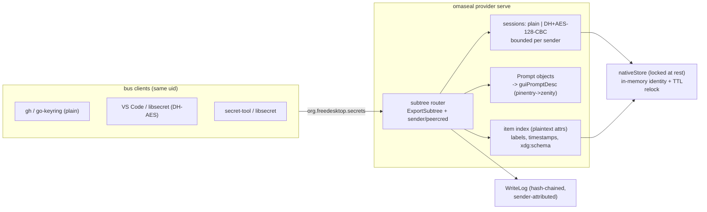
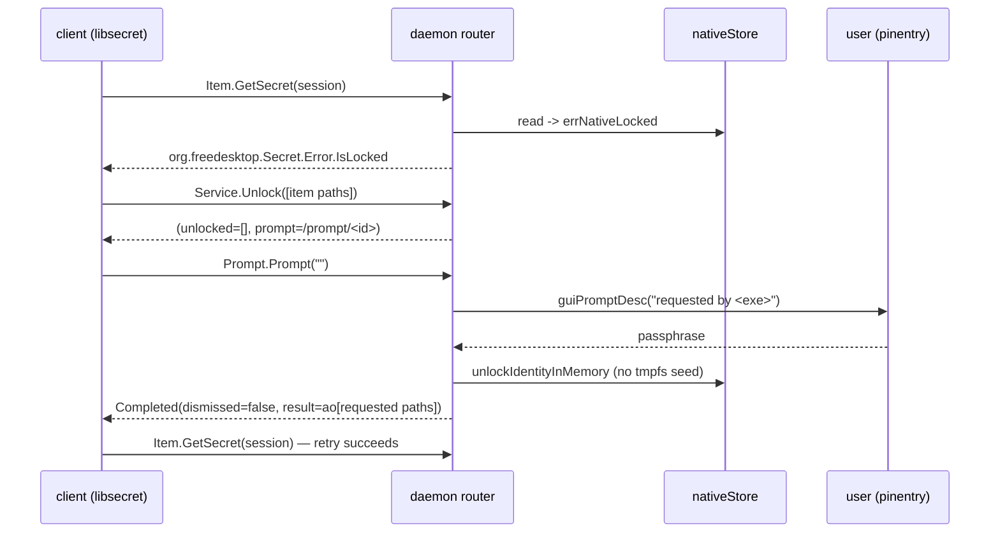
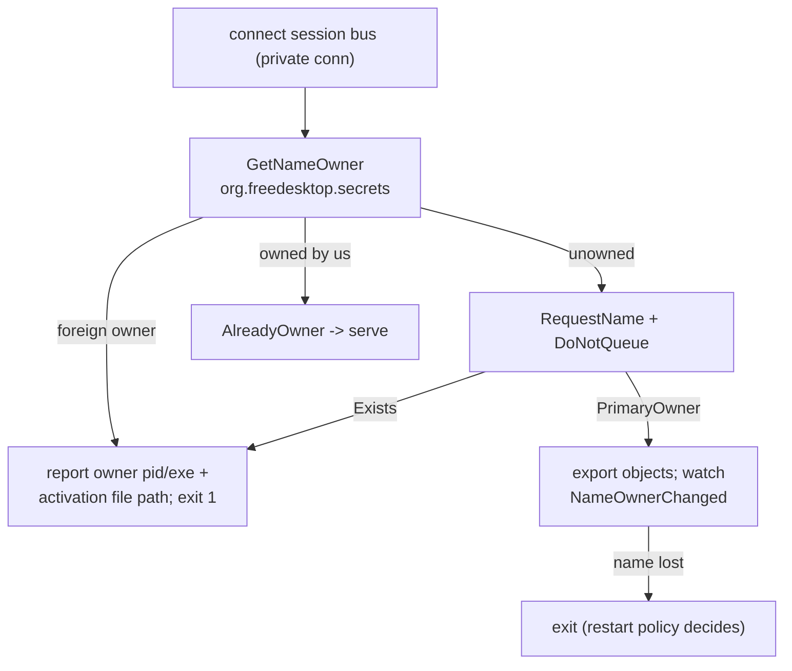

# Plan — Secret Service provider daemon

## Goal Capsule

OmaSeal owns the `org.freedesktop.secrets` well-known name on the user's session
bus and serves the freedesktop Secret Service API from the native store, so any
stock libsecret client — VS Code, `gh`, Electron apps, `secret-tool` — reads and
writes the vault with zero per-app work. The daemon is a serving layer, not a
data layer: CLI/MCP behavior is unchanged and works with or without it.

**Predecessors:** panel extraction plan (`docs/plans/2026-10-10-001`) and the
clipboard-save feature land first per the origin doc's sequencing; this plan has
no file-level dependency on them — the daemon never touches QML.

## Product Contract

Origin requirements verbatim (`R1`–`R14`, `F1`–`F7`):
`docs/brainstorms/2026-10-10---secret-service-provider-daemon-requirements.md`.
This plan adds no product requirements; Key Decisions below record the
session-settled product choices.

### Key Decisions

- **Accept `plain` alongside DH transport.** `go-keyring` — the client inside
  `gh`, docker credential helpers, and OmaSeal's own `secretservice` backend —
  negotiates `plain` only; refusing it breaks the feature's named clients.
  The wire ceiling is documented, not enforced (KTD1). (session-settled:
  user-approved — chosen over AES-only refusal)
- **v1 access boundary = uid peercred + store lock + Prompt.** KeePassXC-style
  per-client authorization prompts are deferred; v1 is gnome-keyring parity
  plus the uid check and audit attribution gnome-keyring lacks (KTD4).
  (session-settled: user-approved — chosen over per-client trust prompts)
- **Enable shadows, never masks the competitor's unit.** `provider enable`
  writes a user-level activation file; `doctor`/`status` warn on foreign
  ownership but nothing auto-disables gnome-keyring, which also carries SSH
  keys (KTD6). (session-settled: user-approved — chosen over unit masking)
- **Daemon unlock is in-memory only.** A bus `Unlock` never seeds the tmpfs
  session files the CLI reads — it writes a non-secret `unlock-epoch` marker
  instead, so every armed state has an observable file transition; a TTL
  re-lock (`agent.json` `SessionMinutes`, default 15m) plus the marker watch
  bound the window (KTD2). (session-settled: user-approved — chosen over
  shared `seedSession` to avoid silently arming every same-UID process)

## Planning Contract

### Key Technical Decisions

- KTD1. Serve `plain` and `dh-ietf1024-sha256-aes128-cbc-pkcs7` transports;
  reject unknown algorithms with `org.freedesktop.DBus.Error.NotSupported`.
  libsecret prefers AES and falls back on `NotSupported`; go-keyring is
  plain-only. Document that `plain` exposes secret bodies to same-UID bus
  monitors — the name owner is the trust root regardless. Governs U1.
- KTD2. Daemon identity carries provenance, and every armed state leaves an
  observable marker. **File-derived:** the daemon may adopt a valid tmpfs
  session via `loadSession` — the per-call stat of the session files
  propagates `omaseal agent lock` (file removal → drop identity), and a
  `provider serve` restart inherits a live CLI unlock. **Prompt-derived:** a
  bus `Unlock`/`Prompt` calls a new `unlockIdentityInMemory`-style entry that
  skips `seedSession` (no `native-session.{age,json}` writes — a bus unlock
  never arms the CLI/tmpfs surface) and writes a daemon-owned
  `unlock-epoch` marker in `agentRuntimeDir()` (epoch + expiry, no key
  material). The per-call stat watches **the marker**: `agent lock` unlinks
  it alongside the session files, `Service.Lock` and the TTL timer unlink it
  too, and marker-absent → drop prompt-derived identity. This gives every
  armed state a real file transition — file-derived (session files) and
  prompt-derived (marker) — without the CLI needing a bus client to reach a
  hung daemon. Whichever expiry is sooner wins per provenance.
  (session-settled: user-approved — in-memory unlock chosen over shared
  `seedSession` to avoid silently arming every same-UID process; marker +
  provenance split added at deepening) Governs U2, U5.
- KTD3. Every returned object path is reachable: `ExportSubtree` on
  `/org/freedesktop/secrets` with a custom router recovering the called path
  from `dbus.Message`. godbus merges every subtree-exported interface at every
  subpath, and member names collide across interfaces (`Delete` on
  Item+Collection; `SearchItems` on Service+Collection with different
  signatures) — so dispatch keys on **(path class, FieldInterface, member)**,
  cross-class calls return `NoSuchObject`/`UnknownMethod`-class errors, and an
  empty interface header resolves deterministically by path class (never the
  random interface-map scan). Item/collection/session/prompt ids mint
  hex-encoded (`[A-Za-z0-9_]` charset). Properties are served store-backed by
  the router — not `prop.Export`, which is snapshot-bound and lies for
  externally-created items (gopass-secret-service c03243b). Governs U3.
- KTD4. Per-call policy: resolve `dbus.Sender` → `GetConnectionUnixUser` /
  `GetConnectionUnixProcessID`, deny non-owning uids, and log
  `sender=:1.N pid=N exe=…` on every secret-serving call. `agent mode lock`
  denies the bus outright — evaluated per call by reading the policy file (a
  file watch would leave a staleness window on a panic control);
  `ask`/`open` serve under store-lock + Prompt rules. Mode-lock denial uses
  `org.freedesktop.DBus.Error.AccessDenied` — returning empty lists or
  `IsLocked` would respectively hit the Chromium orphan trap or spawn
  unlock prompts that can never succeed.
  The AI manifest is not applied to bus clients — `DENY` there means "deny
  agents", not "deny VS Code". Governs U2, U4, U5.
- KTD5. One persistent collection served at `/org/freedesktop/secrets/collection/login`
  with the `default` alias resolving to it; aliases serve the full Collection
  interface (go-keyring hits `/collection/login` first, `aliases/default`
  second). `session` alias and `CreateCollection` are deferred. Governs U3, U4.
- KTD6. `RequestName` with `DoNotQueue`, never `AllowReplacement`; non-
  `PrimaryOwner` → non-zero exit (systemd unit fails rather than races).
  Subscribe `NameOwnerChanged` on our own name and exit on loss (gnome-keyring
  pattern). `provider enable` writes
  `~/.local/share/dbus-1/services/org.freedesktop.secrets.service` + a
  `Type=dbus`/`BusName=` user unit — the user dir shadows the system dir;
  `disable` removes them. Governs U2, U6.
- KTD7. Item metadata (attributes, label, timestamps) lives in a plaintext
  daemon-side index; secret bytes stay in the native store. The index is
  **authoritative for attributes** — `nativeEnvelope` stores only
  svc/acct/value, so `items.json` is the sole copy of attribute dicts; it is
  durable state (atomic writes, `.bak` retention on corruption, corruption
  surfaced by `doctor`/`status`), not a rebuildable cache — index loss means
  permanent attribute-metadata loss (secrets survive; attribute-search does
  not). The item **set** is derived-complete over the store: reconciled at
  startup and on store mtime so CLI-created items appear (synthesized attrs)
  and CLI-deleted items disappear — without this, the Chromium trap recreates
  itself via `omaseal set`. `SearchItems` on a locked store must return item
  paths in the `locked` list — never empty-unlocked (empty makes Chromium
  regenerate its key and orphan everything it encrypted). Read methods that
  return secrets (`GetSecrets`, `Item.GetSecret`) carry no locked list — they
  error `IsLocked` and the client drives `Unlock` (per spec, only
  Unlock/Lock/Delete/CreateItem/CreateCollection mint Prompts). Governs U4.
- KTD8. Prompt objects drive `guiPromptDesc` (pinentry→zenity stack) with the
  caller's `/proc/<pid>/exe`-resolved name in the dialog text — `requesterName()`
  reads ppid, which is `systemd` under a daemon. `Prompt`/`Dismiss` are
  owner-sender-only; prompts are deduped and rate-limited on the `sudorate`
  pattern. `Completed` emits exactly once with a valid variant. Governs U5.
- KTD9. The systemd user unit ships in the package at
  `/usr/lib/systemd/user/` — inert (no `[Install]`/enablement), satisfying
  R14's "installed inert" in letter. The D-Bus activation file **cannot** ship
  at `/usr/share/dbus-1/services/` — pacman file-conflicts with
  gnome-keyring's own `org.freedesktop.secrets.service`; it is an embedded Go
  string written by `provider enable` into `~/.local/share/dbus-1/services/`
  (the user dir shadows the system dir). R14 is met in outcome, not letter:
  record the deviation. `provides=('org.freedesktop.secrets')` stays out —
  nothing provides the name until `enable` runs. Governs U6.
- KTD10. `omasealError` codes map to real Secret Service error names
  (`locked`→`org.freedesktop.Secret.Error.IsLocked`, `not_found`→`NoSuchObject`,
  missing session→`NoSession`) via `dbus.NewError` — libsecret branches on the
  error name, not the message. Governs U3.
- KTD11. The daemon is the `provider` verb on the same binary (`provider
  serve|status|enable|disable`), not a second binary. New symbols **and files**
  take `svc*` prefixes — `ss*` already means the *client* side (`ssStore`,
  `keyring.go` import alias) and `provider*` already names the op/bw resolvers
  (a `provider.go` file would sit one character from `providers.go`). The
  user-facing verb keeps the requirements-mandated `provider` name (R4); the
  README disambiguates it from resolve-providers. Governs U2.

### High-Level Technical Design

Component topology:

Unlock/Prompt flow — the locked-store path (per spec, only
Unlock/Lock/Delete/CreateItem/CreateCollection mint Prompts; locked reads like
`GetSecrets`/`GetSecret` error `IsLocked` immediately — they carry no prompt
out-param):

The `Completed` result variant is per-op typed: for `Unlock` it is the `ao` of
newly-unlocked paths **echoing the requested paths** — go-keyring appends it
to the method's `unlocked` return and requires `len==1`, so the method-return
and prompt-delivered sets must be disjoint.

Ownership/contention gate at `provider serve` startup:

### Sequencing

Phase 1 lands U1+U2 (crypto + daemon scaffold) — nothing is servable but the
scaffolding and crypto are fully testable alone. Phase 2 lands U3+U4+U5 (object
surface, store bridge, prompts) — the daemon becomes functional. Phase 3 lands
U6+U7+U8 (management verb, conformance CI, pentest program). Each unit is a
committable slice; U1–U5 could reasonably be one PR or three.

## Implementation Units

### U1. Session transport codec (plain + DH-AES)

**Goal:** Correct, spec-exact session crypto in pure Go — the most
error-prone surface, fully testable without a bus.

**Requirements:** R1, R8 (codec determinism feeds conformance tests).

**Dependencies:** none.

**Files:** `engine/svccrypto.go`, `engine/svccrypto_test.go`.

**Approach:** RFC 2409 Second Oakley Group 1024-bit prime (verbatim constant),
generator 2, `math/big` modexp; shared secret encoded **fixed 128-byte
big-endian** (`FillBytes`) before `HKDF-SHA256(ikm, salt=nil, info=nil) → 16-byte
key`; AES-128-CBC + hand-rolled PKCS#7. Validate peer pubkey `1 < peer < p-1`
(degenerate keys force known secrets). `plain` is a pass-through that accepts
any input variant content (libsecret sends an empty `s`). `hkdf` and `x/crypto`
are already in the module graph.

**Test scenarios:** round-trip encrypt/decrypt both transports; fixed-vector
test against a computed known-good pair (or cross-check against the keybase
`go-keychain/secretservice` client implementation); unpadded-shared-secret
regression (leading-zero case — docker/secrets-engine#547 class); degenerate
pubkey rejection (`0`, `1`, `p-1`, `p`, out-of-range); wrong-key decrypt fails;
PKCS#7 bad-padding rejection; unknown algorithm name rejected.

**Verification:** `cd engine && go test -run 'SSCrypto|DH|Session' ./...` passes
with deterministic vectors.

### U2. Daemon scaffold, name lifecycle, and caller identity

**Goal:** `omaseal provider serve` owns the bus name politely, resolves caller
identity for policy + audit, and stays resident until it loses the name.

**Requirements:** R4, R5, R6 (hardening entry points), R7.

**Dependencies:** none (U1 is parallel; U2's tests stub crypto).

**Files:** `engine/svcverb.go` (verb dispatch + serve loop), `engine/svcbus.go`
(connection + name lifecycle + peercred helpers), `engine/svcverb_test.go`,
`engine/main.go` (add the `provider` case + usage lines).

**Approach:** private bus connection (`dbus.Connect`/`SessionBusPrivate` — the
shared `SessionBus()` handle is wrong for a server and breaks private-bus
tests); `RequestName(DoNotQueue)` → exit 1 on `Exists`/`InQueue` replies
(`AlreadyOwner` means a stale prior claim of ours — proceed to serve);
`NameOwnerChanged` watch on both the well-known name (exit on loss) and each
client unique name (reap its sessions/prompts on disconnect — clients commonly
never call `Session.Close`); wire `dbus.Sender`→`GetConnectionUnixUser`/
`GetConnectionUnixProcessID`→`/proc/<pid>/exe` helper used by every later
unit; `PR_SET_DUMPABLE(0)` early; `WriteLog` gains sender attribution on
daemon lines. Dispatch `provider` before `selectStore()` or tolerate its
error — a corrupt `config.json` must not kill the daemon over config it never
reads. `serve` fails fast with remediation when `identity.age` is absent —
an uninitialized store can never satisfy a bus Prompt (init needs a TTY), so
clients must see `ServiceUnknown`, not a permanently erroring provider;
`enable` warns on the same condition. Daemon state bypasses `currentStore` entirely — it holds
`newNativeStore()` directly (`backendmigrate.go:151` precedent), so
`backend: secretservice` cannot recurse into itself. All daemon state
(identity, session map, item index, prompt map) sits behind one `daemonMu` —
godbus runs every method call in its own goroutine and `handleCall` has no
`recover`, so an exported-method panic kills the daemon and hangs every
prompt-waiting client (go-keyring waits forever): the router wraps dispatch
in `recover` → `Failed`, and prompt/prompter waits run **off** the mutex (a
5-minute dialog must not starve the bus).

**Patterns to follow:** `handleJev` for sub-verb shape, `fprintd.go` name-owner
probe + sender-verified signal discipline, `writeFileMode` for file writes.

**Test scenarios:** name claim succeeds on a private bus; foreign owner →
exit-1 path reports owner; `DoNotQueue` semantics (Exists reply handled);
sender→uid/pid/exe resolution against a real client connection; name-loss →
serve returns; deny-wrong-uid policy check shape (fixture with a stubbed creds
call).

**Verification:** private-bus tests green; `omaseal provider serve` claims then
relinquishes cleanly under `dbus-run-session`.

### U3. Object router, properties, and error mapping

**Goal:** The whole exported object tree answers correctly — Service,
Collection (incl. alias paths), Item, Session, Prompt — with store-backed
properties and spec error names.

**Requirements:** R1, R3 (Prompt object shape), F1 (correct behavior under
contention reporting).

**Dependencies:** U1, U2.

**Files:** `engine/svcobjects.go` (Service/Collection/Item/Session/Prompt
method sets), `engine/svcrouter.go` (subtree router + properties),
`engine/svcerrors.go` (code→D-Bus-error-name map), `engine/svcobjects_test.go`.

**Approach:** one `ExportSubtree` at `/org/freedesktop/secrets`; the router
dispatches on (path class, interface, member) per KTD3. Surface inventory the
unit must implement — Service: `OpenSession`, `CreateCollection`(→
unsupported-deferred: return a Prompt-free error or NotSupported),
`SearchItems`, `Unlock`, `Lock`, `GetSecrets`, `ReadAlias`, `SetAlias`,
property `Collections` (must return `[/collection/login]` — go-keyring reads
it before falling back to the alias path). Collection (real path + alias
paths): `Delete`, `SearchItems`, `CreateItem`, properties `Items`, `Label`
(rw), `Locked`, `Created`, `Modified`. Item: `Delete`, `GetSecret`,
`SetSecret`, properties `Locked`, `Attributes` (rw), `Label` (rw), `Created`,
`Modified`, plus the tolerated non-spec `Type` (default
`org.freedesktop.Secret.Generic`). Session: `Close`. Prompt: `Prompt`,
`Dismiss`. Signals: `CollectionCreated/Changed/Deleted`,
`ItemCreated/Changed/Deleted`, `Completed`, `PropertiesChanged`. `Collection.
Delete` on the singleton refuses (a vault isn't deletable). Wire constants
split across `keyring.go`/`keyringmigrate.go` unify here; add the missing
`org.freedesktop.Secret.Session` interface constant. **Introspectable is
served by our own dispatch**, not godbus's built-in: the built-in merges
only on the subtree-fallback branch and enumerates only statically
registered children, so it can never show the item tree — the router serves
`Introspect(msg)` generating per-path-class XML (one subtree registration
covers root + children; `busctl --user introspect` stays a valid acceptance
check). `omasealError` codes map to
`org.freedesktop.Secret.Error.*` names via `dbus.NewError`.

**Test scenarios:** every spec method callable at its path with correct
signature (strict godbus arity); alias path `/org/freedesktop/secrets/aliases/default`
serves the Collection interface; `ReadAlias` returns `/` when unset;
wrong-signature calls return `InvalidArgs`; locked store → `IsLocked` (name,
not message); unknown object → `NoSuchObject`; unknown session → `NoSession`;
property Get/Set/PropertiesChanged round-trips; `Unlock` accepts item paths as
well as collection paths.

**Verification:** private-bus client (godbus) exercises the full surface;
`busctl --user introspect` shows the tree when run manually.

### U4. Store bridge — item registry, attributes, locked-search semantics

**Goal:** Native store entries appear as spec items with attributes searchable
while locked; all CRUD is sender-checked.

**Requirements:** R1, R2, R7.

**Dependencies:** U3.

**Files:** `engine/svcitems.go` (item index + native-store mapping),
`engine/svcitems_test.go`.

**Approach:** a daemon-owned plaintext index (`items.json` under
`$XDG_STATE_HOME/omaseal/`, `0600` — authoritative for attributes per KTD7:
atomic writes, `.bak` retention, corruption surfaced by doctor/status)
records object id ↔ service/account + attributes + label + timestamps; secret
bytes only via `nativeStore`. `xdg:schema`, `application`, `service`,
`account`, and arbitrary keys are preserved verbatim; items lacking
addressable attrs are listed-but-unmapped (mirroring `List`'s skip behavior).
`SearchItems`/`GetSecrets` on a locked store list item paths in the `locked`
return — never empty-unlocked. Items carrying no `service`/`account` attributes (Chromium's shape is
`{application, xdg:schema}`) get a deterministic synthetic key —
`dbus:<sha256 of the canonical attribute dict>` as the account under a fixed
service namespace — so they persist, dedup on attribute-dict equality
(gnome-keyring CreateItem semantics: same attrs + `replace` flag → update),
and stay listed-but-not-CLI-addressable. `CreateItem`/`Delete`/`SetSecret`/
`GetSecret`/`SetAttributes` work under the native store's existing
locked-write semantics, each gated by KTD4 sender rules + per-sender session
ownership — a foreign session path cannot **use** (read or write) another
client's session. Caps: 1 MiB secret + bounded attribute-dict size (hoist
`maxSecret` out of `readSecretFrom` to package scope first — it is
function-local today); item/session/prompt budgets key on the resolved
**uid**, not the unique sender name — a reconnect churns `:1.N` and must not
reset the budget — plus a global ceiling for the daemon's maps. Item path
ids derive deterministically from the escaped native store key (hex-encoded)
so they survive restarts and index rebuilds; only bus-created items with no
store row mint fresh ids. `escKeyPart` safety for attribute→key mapping.

**Test scenarios:** create→search→get→set→delete round-trip; attributes
searchable while locked (no decrypt); locked `SearchItems` returns paths in
`locked` list (Chromium trap); foreign-sender session use denied;
oversized secret rejected; attribute dict with `xdg:schema` + arbitrary keys
survives round-trip; item with no `service`/`account` attrs is listed but not
CLI-addressable; concurrent daemon+CLI write keeps store coherent (flock
precedent); index corruption → fail-closed rebuild behavior defined.

**Verification:** round-trip tests + concurrency test green on private bus.

### U5. Unlock path, Prompt objects, and lock lifecycle

**Goal:** Locked operations mint spec Prompts that drive the masked GUI
prompter; unlocks arm an in-memory identity with a TTL; locks propagate both
directions.

**Requirements:** R3, F5 (documented first-access prompt), R10.

**Dependencies:** U2, U4.

**Files:** `engine/svcprompt.go` (Prompt objects + rate limit/dedup),
`engine/nativestore.go` (in-memory unlock variant — additive, forked at
`unlockIdentity`'s `seedSession` call ~line 335), `engine/agent.go`
(`agent lock` unlinks the `unlock-epoch` marker too — the prompt-derived
invalidation channel per KTD2),
`engine/svcprompt_test.go`, `engine/nativestore_test.go` (new cases).

**Approach:** intercept `errNativeLocked` at the store call inside
`Unlock`/`Delete`/`CreateItem`/`CreateCollection` (the only prompt-minting
methods — reads error `IsLocked` per KTD7); mint a sender-owned Prompt whose
`Prompt()` runs `guiPromptDesc` (caller exe in the text) →
`unlockIdentityInMemory(pass, expiry)` → `Completed` echoing the requested
paths (disjoint from the method's `unlocked` return — go-keyring appends the
two). Non-GUI callers get the documented fail-closed error — never a dialog.
Re-lock and propagation follow the KTD2 provenance rules; prompter waits and
`guiPromptDesc` spawns run off `daemonMu` (KTD-U2 locking discipline).
`Lock` drops prompt-derived identity + unlinks session files. Prompt caps +
a limiter/dedup borrowing the `sudorate`/`promptLock` *policy* shape
(window, max, single-flight by pending op — both are cross-process file-lock
mechanisms, so only the policy transfers to an in-process map); `Dismiss`
owner-only; mid-op Dismiss honored, `Completed`-already-sent race is legal.
Headless/no-prompter → prompt completes `dismissed=true` fast or the op
errors — never a hang (clients wait with no timeout).

**Test scenarios:** locked `GetSecret` → `IsLocked` error (no prompt — reads
carry none); locked `Unlock` → prompt path returned, `Completed` echoes the
requested paths and is disjoint from the method's `unlocked` return; wrong passphrase → Completed dismissed or
error, identity stays cleared; Dismiss from owner aborts; Dismiss from
foreign sender denied; two callers → independent prompts; prompt flood
rate-limited; TTL expiry re-locks without serving; file-derived identity:
`agent lock` file removal detected on next call; prompt-derived identity:
`agent lock` marker removal detected on next call — provenance-aware, since
daemon-armed unlocks have no session files to remove (both channels covered);
no prompter (no pinentry/zenity paths) → fail-closed, no hang.

**Verification:** prompt flow tests drive a scripted `nativePromptGUI` stub on
the private bus; a real `secret-tool` get against a locked store prompts once
and serves.

### U6. `provider status|enable|disable`, doctor, and packaging

**Goal:** Users can inspect ownership, install/remove the activation shadow +
unit, and get honest diagnostics.

**Requirements:** R4, R5, R7, R14, F7; plus the documentation homes for F2
(DE spread), F4 (headless/SSH CLI unchanged), and F6 (portability) — the
README feasibility section is where those outcomes land.

**Dependencies:** U2 (serve exists to enable), U5.

**Files:** `engine/svcverb.go` (verb bodies — same file as U2's dispatch),
`engine/svcfiles.go` (embedded templates + writers — single-token name,
not snake_case), `engine/doctor.go` (provider check), `engine/main.go`
(`usage()` lines), `packaging/aur/PKGBUILD{,-bin}` + `.SRCINFO` regeneration
(provides/depends decision), `README.md`, `ROADMAP.md`,
`engine/svcfiles_test.go`.

**Approach:** `enable` writes `~/.local/share/dbus-1/services/
org.freedesktop.secrets.service` (`SystemdService=omaseal-provider.service`
**plus** `Exec=/usr/bin/omaseal provider serve` — the Exec fallback keeps
activation alive on dbus builds without systemd support; harmless under
systemd, SystemdService wins) and `~/.config/systemd/user/
omaseal-provider.service` (`Type=dbus`, `BusName=`, hardening directives
`LimitCORE=0`, `NoNewPrivileges=yes`) via `writeFileMode`; then runs
`systemctl --user daemon-reload` (systemd does not auto-scan new unit files —
without this the just-enabled unit resolves to NoSuchUnit). `disable` runs
`systemctl --user stop omaseal-provider.service` first — a running daemon
keeps owning the name otherwise, and F7's fallback is false mid-session —
then removes both files and daemon-reloads; on non-systemd sessions the stop
is skipped with a printed note that the live daemon holds the name until
exit. `enable` refuses without `--force` when a foreign owner is live, and
always reports the resolved activation path; it also warns when the name is
gnome-keyring-owned **and** unmigrated data may exist. `omaseal migrate`
guards the self-serve trap: if `GetNameOwner` resolves to our own binary
(pid→`/proc/<pid>/exe`, the U2 helper), it refuses with "disable the
provider first" — otherwise post-enable `migrate` silently reads the daemon's
own native store and reports "nothing to migrate".
`status` prints owner name/pid/exe + enabled state + resolved activation
file. `doctor`'s `checkSecretService` currently probes for a `gnome-keyring`
binary + `ps` scan and would hard-fail once we own the name — it gains a
session-bus `GetNameOwner` probe and an "omaseal owns it" verdict (bigger than
a branch: doctor touches only the system bus today). `status`/`doctor` also
warn when the daemon env lacks `WAYLAND_DISPLAY`/`DISPLAY` — a `Type=dbus`
unit inherits only the user-manager env, so prompter reachability is not
guaranteed (fail-closed, but the warning names it). PKGBUILD ships the systemd user unit at `/usr/lib/systemd/user/` inert
(KTD9 — the activation file can't ship; it would file-conflict with
gnome-keyring's); no `provides=('org.freedesktop.secrets')` — nothing
provides the name until `enable` runs. `.SRCINFO` files mirror the
PKGBUILDs and must be regenerated with any `depends`/file-list change. Resident lifecycle — no
idle exit (prior art: nobody exits; re-activation is free anyway).

**Test scenarios:** enable writes both files with right content/mode +
`Exec=` fallback line; enable runs daemon-reload (mocked systemctl); enable
with foreign owner reports + refuses without forcing; disable stops the unit
before removing files (mocked) and skips stop on non-systemd sessions;
migrate refuses when the name resolves to our own binary; status parses
owner correctly across owned/foreign/unowned; unit template parses
(`systemd-analyze --user verify` where available).

**Verification:** file-write tests + a manual enable→restart→`busctl` check on
a live session.

### U7. Conformance suite and CI wiring

**Goal:** The protocol is proven deterministically — private-bus tests plus
real libsecret/go-keyring clients in CI.

**Requirements:** R8, R9, R10, R13.

**Dependencies:** U3, U5.

**Files:** `engine/svcconformance_test.go` (private-bus fixture + assertions),
`.github/workflows/ci.yml` (add `libsecret-tools`; dbus-daemon already
present via dep chain — verify), `engine/keyring_test.go`-adjacent e2e.

**Approach:** fixture spawns `dbus-daemon --session --print-address=1
--print-pid=1 --fork` per test (present in CI — `dbus-run-session` already
wraps the suite, and private buses coexist with it since `dbus.Connect(addr)`
ignores the env address); daemon-under-test connects at that address, a
second connection plays client; all waits are event-driven (signal watches,
no sleeps). CI's test job adds an arm64 runner (`ubuntu-24.04-arm`) — today
only amd64 tests run while arm64 is build-only, and arm64 is a ship target.
e2e lane (env-gated like `OMASEAL_IT=1` + a CI job step):
`secret-tool store|lookup|clear` round-trip; the go-keyring self-test —
OmaSeal's own `secretservice` backend reads what our provider wrote — runs in
a **subprocess** (the built `omaseal` binary with `DBUS_SESSION_BUS_ADDRESS`
set to the private bus), never in-process: `ssStore` uses godbus's shared
`SessionBus()` handle, which would pin every in-process keyring test to
whichever bus was env-set first. A libsecret DH-session client proves the
AES path.

**Test scenarios:** full matrix above; name-owner assertions; signal ordering
(`ItemCreated`/`Completed`); a client disconnect reaps its sessions/prompts
(`NameOwnerChanged` GC); secret-tool get on locked store yields the prompt
flow, not a timeout.

**Verification:** `cd engine && go test ./...` green; CI job green on amd64
+ arm64; `OMASEAL_IT=1` lane exercised in CI.

### U8. Pentest program (planned, recurring)

**Goal:** The threat model becomes a maintained program with an executable
harness, not a one-off review.

**Requirements:** R11, R12. The threat floor is R11's named minimum list —
each is a required entry, mapped here to its harness shape: same-UID theft
(procfs memory, env scraping, ptrace — manual), D-Bus name spoofing
(automatable), prompt hijack (automatable), tmpfs session-file exposure
(automatable), hash-chain log tamper (automatable), unlock brute-force
oracle (automatable), clipboard residue (manual), MCP manifest bypass
(automatable — manifest DENY does not bound bus clients during unlock
windows; document + probe), import-path injection (automatable),
session-file TOCTOU (automatable), daemon crash-during-write integrity
(automatable). Design-review threats extend the floor: foreign-session
writes, `plain` transport monitors, unlocked-window extension,
activation-file shadowing, prompt flooding, memory/coredump exposure,
index tampering + disclosure, log-chain gaming, concurrent-write
integrity, panic-hang (router recover).

**Dependencies:** U6 (the surface exists to attack).

**Files:** `docs/security/pentest-plan.md`, `pentest/` (harness + cases),
`.github/workflows/pentest.yml` (`workflow_dispatch` only).

**Approach:** each threat = one doc entry (attack, expected mitigation,
automated-vs-manual, severity) + where automatable, a `pentest/` case runnable
against a private bus; findings file as `pentest`-tagged issues; cadence note
ties the program to release lines.

**Test scenarios:** harness self-checks (imposter-name claim test, foreign-
sender session write attempt, oversized payload, prompt flood) produce
expected deny/error results; the manual-cadence doc lists what stays manual
(procfs memory, ptrace) and why.

**Verification:** harness runs locally + dispatch job green; plan accepted by
security-review pass.

## Scope Boundaries

### Deferred for later (product roadmap)

- Per-client authorization prompts (KeePassXC-style trust decisions) — phase
  2; the Prompt plumbing this plan builds is its substrate.
- Same-UID confinement hardening (Landlock/seccomp) — R6 scopes it to
  phase 2; the daemon's shape must not foreclose it.
- PAM auto-unlock, xdg-desktop-portal Secret backend swap, KWallet native
  API — origin non-goals.
- `session` (non-persistent) collection alias and `CreateCollection` — v1
  serves one `login` collection + `default` alias.

### Deferred to Follow-Up Work

- `provider replace` / explicit takeover flag (oo7/KPXC convention) — v1
  documents the manual path (stop competitor → serve) instead.
- Flatpak app coverage — requires the portal backend swap (phase 2); native
  packages unaffected.
- `SetAlias` write restriction policy — v1 treats alias writes as benign on a
  single-collection model.

## System-Wide Impact

- The daemon becomes the long-running holder of key material — it inherits
  the memory-hygiene caveats already documented for the native store and adds
  coredump suppression (`PR_SET_DUMPABLE`, `LimitCORE=0`).
- Audit log volume grows with bus traffic; lines carry sender attribution so
  `stats`/`accessLogRe` stay coherent — daemon reads emit `access`-shaped
  lines.
- `agent mode lock` now means "the bus denies too" — a user-visible semantic
  extension of an existing control, documented in README.
- The name is unauthenticated within a uid — a same-UID imposter owning
  `org.freedesktop.secrets` first receives client ciphertext; DH protects
  against passive monitors only. This is a stated limit, not fixable without
  sandboxed-bus mediation; `status`/`doctor` make ownership inspectable.
- **Manifest asymmetry:** while the daemon is unlocked, uid peercred is the
  only gate — a manifest-DENY'd agent is still a same-UID process and can
  drive bus reads. `agent mode lock` is the control that covers the bus; the
  README states this so DENY isn't oversold.
- **Index disclosure:** the item index is plaintext metadata at rest (0600,
  state dir) — any same-UID reader can enumerate service/account/attribute
  names. Deliberate: locked-search needs attributes without the identity.
  Secret values never enter it; the tradeoff is stated here and in the
  pentest doc.
- **ask/open asymmetry:** under `agent mode ask`, a bus client (including a
  constrained agent) can drive a passphrase Prompt and then read freely in
  the window — the Prompt *is* the authorization. Same strength as
  gnome-keyring today; stated so the gate isn't assumed tighter than it is.

## Risks & Dependencies

- **DH codec correctness** — the padding/degenerate-key bug class is
  well-documented (docker/secrets-engine#547; go-xkms' wrong-group bug);
  fixed-vector tests + pubkey validation carry the risk.
- **Chromium key-orphan trap** — locked search must return paths in `locked`,
  never empty-unlocked (KTD7).
- **gnome-keyring contention at login** — PAM-started gnome-keyring may hold
  the name every boot until the user disables its secrets component;
  `status`/`doctor` guidance covers it; no auto-disable (KTD6).
- **Spec is a draft** — ch.11 is a TODO stub; where spec and gnome-keyring
  differ, match gnome-keyring (de-facto spec) — applied to `Item.Type`, error
  names, prompt semantics.
- **Prompt==hang risk** — go-keyring waits on prompts with no timeout;
  `Completed` must emit exactly once on every path incl. failure.
- **pkcs11/ssh coexistence** — gnome-keyring's other components keep running;
  only the name transfers. Documented so nobody "fixes" it later.

## Open Questions

- Does `GetConnectionCredentials` on this distro's dbus expose everything the
  uid/pid path needs, or do we need per-call `GetConnectionUnixUser` +
  `GetConnectionUnixProcessID` calls? Implementation-time check; the helper
  abstracts either.
- Can a running foreign owner be politely asked to release (some providers
  honor `ReleaseName`), or is "stop the unit" the only real path? Verified at
  implementation; does not block.
- Exact canonicalization detail for the U4 synthetic key (sorted-attr dict
  hashing) — settle during implementation; the *rule* is settled: unmappable
  items get `dbus:`-namespaced synthetic keys, persist, and dedup on
  attribute-dict equality.

## Verification Contract

- `cd engine && go test ./...` and `go vet ./...` — module root is `engine/`.
- `gofmt -l engine/` clean.
- Private-bus conformance suite green (`OMASEAL_IT=1` lane for e2e cases).
- CI green on amd64 + arm64 with `libsecret-tools` present; `secret-tool`
  round-trip passes in the CI e2e step.
- Manual acceptance on a live session: `omaseal provider enable` →
  `busctl --user introspect org.freedesktop.secrets /org/freedesktop/secrets`
  shows our objects; `secret-tool store/lookup` round-trips; VS Code/`gh`
  writes land in the vault (`omaseal list` sees them); `provider disable`
  restores the previous provider on next activation.
- Pentest dispatch workflow exists and its harness runs locally.

## Definition of Done

- Every R1–R14 maps to a landed unit or an explicit deferral above; F1–F7
  outcomes are documented behavior with tests where automatable.
- A stock `secret-tool` round-trip works against the daemon on a private bus
  in CI, and on the live session bus after `provider enable`.
- Locked-store access never blocks a D-Bus method — prompt-minting methods
  return a Prompt; read methods return `IsLocked` — and `SearchItems` never
  returns empty-unlocked for a locked vault.
- Daemon unlock never writes `native-session.{age,json}`; TTL re-lock and
  external-lock propagation verified by test.
- Name contention: refuse + report, never race; name loss exits; enable/
  disable round-trips ownership.
- No secrets in logs/argv/env at any point; audit lines carry sender
  attribution; no abandoned-attempt code left in the diff.

## Sources / Research

- Origin: `docs/brainstorms/2026-10-10---secret-service-provider-daemon-requirements.md`.
- Spec: freedesktop Secret Service draft 0.2 (specifications.freedesktop.org/
  secret-service) — draft; gnome-keyring is de-facto authority on deltas.
- godbus v5.2.2 serving surface verified in module cache: `ExportSubtree`,
  `RequestName` flags, `Emit`, `dbus.Sender`/`dbus.Message` injection, strict
  arity, per-call goroutines.
- Prior art: oo7 (resident, Type=dbus unit, `--replace`, PAM/systemd-credential
  login), KeePassXC (refuse-if-owned, Prompt confirmations, peercred exe
  attribution), gopass-secret-service (godbus; subtree-props staleness fix
  c03243b — every returned path must answer), go-xkms (wrong DH group —
  anti-reference for crypto), locket-secret (pubkey validation, locked-search
  handling, error-name branching). Server-plumbing reuse was evaluated and
  rejected: gopass-secret-service is MIT on godbus but couples sessions to
  its own store/entry model and is unmaintained; oo7 is Rust/zbus —
  from-scratch godbus is deliberate, prior art stays a pitfalls reference.
- Client behavior: libsecret tries DH then plain (`secret-session.c`);
  go-keyring plain-only, `/collection/login` → `aliases/default`, attrs
  `{username, service}`, no prompt timeout; Chromium attrs
  `{application, xdg:schema: chrome_libsecret_os_crypt_password_v2}` + a dummy
  unlock item; Emacs `secrets.el` sets `Item.Type`.
- Repo seams: `backendmigrate.go:151` (concrete native store construction),
  `nativestore.go:340` (`errNativeLocked` intercept point), `guiprompt.go`
  (`guiPromptDesc`), `fprintd.go:105-138` (sender-verified signals +
  `GetNameOwner`), `sudorate.go` (rate-limit shape), `writeFileMode`
  (`mcpinstall.go:497`), wire constants `keyringmigrate.go:31-38`,
  prompt client contract `keyringmigrate.go:66-98`.
- Threat model: full inventory in the security research digest — C1
  (daemon-held identity / tmpfs arming), C2 (ambient-authority policy),
  H1 (name spoofing = trust root), H2 (prompt hijack/attribution),
  H3 (foreign-session writes), H4 (plain transport), M1–M4 — each carried
  into KTDs or the pentest unit.
