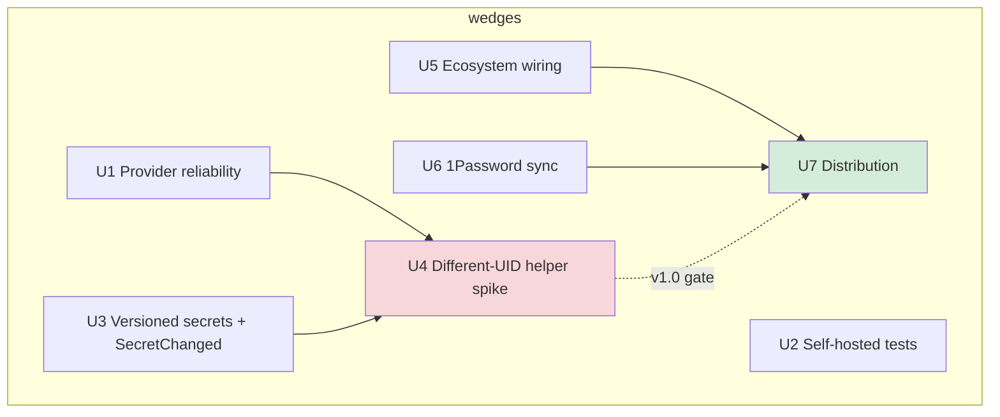

## Goal Capsule

- **Objective:** OmaSeal is a publicly installable, trustworthy first-party Omarchy keyring — a user who is not the author can `yay -S omaseal` (or install via the Omarchy marketplace), get durable Secret Service ownership, and have agent policy actually enforced rather than advisory.
- **Means:** seven independently-shippable wedges, sequenced reliability → versioning → security boundary → ecosystem → distribution; each wedge lands as its own ce-plan + PR (KTD2, KTD5). Order rationale: the provider already died silently once on the dogfooded machine (2026-10-28, PID observed) — reliability is observed risk, not hypothetical; U4 is the highest-uncertainty wedge and its spike runs early enough to de-risk before distribution, not after it.
- **Authority:** this plan's wedge order and boundaries; per-wedge implementation plans govern their own internals; `docs/decisions/setec-design-notes.md` governs helper-daemon architecture choices.
- **Stop conditions:** shipped wedge fails review or pentest; a wedge's entry criteria unmet (e.g. AUR registration still closed); evidence that a settled decision cannot work.
- **Execution profile:** long-horizon program; each unit is one PR-or-more of work, gated per Verification Contract.

---

## Product Contract

### Summary

OmaSeal already functions as the author's daily keyring — 836 secrets, live Secret Service provider, 7 wired agents, encrypted-at-rest store, rotation flags, revamped CLI. The product gap is everything between that and a stranger trusting it: the provider daemon can die silently, the test suite cannot validate itself on a dogfooded machine, same-UID policy is advisory by design, three agents are unwired, BrowserOS resolution is unverified, and nobody can install it publicly. This plan sequences the remaining work into wedges that each ship independently.

### Problem Frame

The architecture decision is already made: the Setec design-read (`docs/decisions/setec-design-notes.md`, #54) concluded that every security property worth having — client identity, sealed keys, one enforcement door — requires the store's owner to be a different principal than its callers. Locally that means a different-UID helper daemon (#59). Everything else in this roadmap is either protecting what already works (reliability), finishing the ecosystem (wiring, sync), or making the product reachable (distribution).

### Requirements

**Reliability**

- R1. The Secret Service provider daemon recovers from silent exit: `Restart=` policy covers bus-activated and systemd-spawned providers alike, and `provider status` reports last-exit provenance so a dead provider is never mistaken for a live one.
- R2. `go test ./...` passes on a machine where omaseal owns `org.freedesktop.secrets` — keyring-compat tests either route through the provider correctly or skip with a clear self-provider signal (issue #62).

**Security**

- R3. Secrets are versioned in the native store: every `set` appends a version, reads return the active version, version numbers are never reused even after tombstone, and change notifications let watchers refresh without polling (issue #60).
- R4. Agent policy is enforced by a principal a same-UID process cannot bypass: a different-UID helper daemon owns the store identity and brokers reads; manifest DENY becomes real for every lane, not just MCP (issue #59).
- R5. The helper daemon binds process identity to agent claims — peer credentials (pid/exe) verified with PID-reuse and exe-replacement awareness; what cannot be bound is documented as out-of-enforcement.

**Ecosystem**

- R6. Remaining detected agents are wired: Copilot MCP config, `gh` credential-helper decision implemented, Agent Zero launcher resolves through omaseal (issue #63).
- R7. BrowserOS resolves `omaseal://` references at request time with a typed failure mode, verified end-to-end (issue #64).
- R8. `omaseal sync 1password` performs two-way sync with canonical key mapping, `--dry-run` plan, `--prefer` conflict resolution, and never silent-overwrite (issue #61).

**Distribution**

- R9. A non-author user can install omaseal: Omarchy marketplace listing first (no external blocker), then `omaseal-bin` on AUR when registration reopens (issue #12).
- R10. Public-facing docs and release discipline match the shipped CLI surface — grouped command tree, rotation flags, provider — so an external reader can self-onboard.

### Key Decisions

- **Different-UID helper is the security architecture** — chosen over deepening same-UID policy gates; same-UID gating is friction, not confinement. `session-settled: user-directed`. Governs R4, R5.
- **Manifest policy stays MCP-scoped; CLI/IPC lanes stay trusted** — same-UID callers can exec the CLI anyway, so gating those lanes protects nobody; real DENY waits for the helper (issue #37, closed on this basis). `session-settled: user-directed`. Governs R4.
- **Jev remains optional, disabled by default** — decision/audit layer, never an authority in the core path. `session-settled: user-directed`.
- **arm64 portability is a hard constraint** — the primary machine is Asahi M1 Max; nothing in the roadmap may regress linux/arm64.
- **Encrypted at rest is non-negotiable** — no plaintext `secret=` values, no unencrypted cache of the real identity.

### Success Criteria

- `omaseal provider status` on a dogfooded machine shows omaseal owning the bus after reboots and daemon kills, with recovery logged.
- `go test ./...` green on omarchy-max (currently 6 env-failures, #62).
- A hostile same-UID process without the session passphrase cannot read a DENY-marked secret after U4 lands — pentest scenario, not a claim.
- `yay -S omaseal-bin` (or marketplace equivalent) installs a working omaseal on a fresh Omarchy machine.
- No secret-loss or exposure event across the program, evidenced by artifacts: pre-sync/migration encrypted backups exist and restore-tested, helper-boundary pentest results published per wedge, sync dry-run logs carry no values.

### Open Questions

- **OQ1 (blocking U7's claim, not its code):** may public distribution ship before U4? The listing can carry an explicit “policy enforcement is advisory until the helper lands” line, or “trustworthy” waits for U4. The wedge itself is not gated — the claim is. (Reviewers converged on this; it is a product-positioning call.)

### Scope Boundaries

**Deferred for later**

- Conditional get / watcher fan-out beyond `SecretChanged` (setec's 304-style fetch) — needs consumers first.
- 1Password conflict-resolution UX beyond `--prefer`/`--dry-run` (interactive merge).
- fprintd rollout on this machine — presence gate stays GUI-confirm until `fprintd` is installed; not a code task.

**Deferred to Follow-Up Work** (planned, separate PRs/issues — each wedge gets its own ce-plan when picked up)

- Marketplace marketplace re-validation of the install.sh pin against the post-revamp tree.
- v1.0 API freeze (`service/account` + IPC) — needs third-party consumers first (ROADMAP U8).
- Secret Service client-compat path deletion once native is the only live backend (ROADMAP simplification note).

**Outside this product's identity**

- Jev as a required layer — stays optional forever.
- A hosted/team vault service — OmaSeal is local-first.
- Replacing gnome-keyring for pkcs11/SSH — gnome-keyring survives pkcs11-only by design.

---

## Planning Contract

### Key Technical Decisions

- KTD1. **Helper daemon brokers, provider adapts.** The different-UID helper owns the store identity and policy; the existing provider daemon becomes a thin Secret Service adapter in front of it rather than a competing enforcement point (`session-settled: user-directed — chosen over same-uid policy hardening: setec read showed confinement needs a separate principal`). Governs U4.
- KTD2. **Wedges ship independently.** Each unit lands as its own branch/PR/ce-plan; no mega-PR spanning wedges. Roadmap order is risk-ordered, not a dependency chain except where noted.
- KTD3. **Versioning ships standalone before the helper.** Independent value: rotation flags already treat “stored a new value” as a lifecycle event — versions make rotation history and audit first-class; the helper will likely want them too, but they justify themselves.
- KTD4. **Provider reliability is a supervision-coverage problem, not a redesign.** `provider serve` exits non-zero on lost-name and the unit’s `Restart=on-failure` re-execs; on systemd sessions the D-Bus activation file’s `SystemdService=` already delegates bus-activated spawns to the unit, so the uncovered surface is the non-systemd `Exec=` fallback plus exit provenance. A keeper/watchdog (precedent: the local `omaseal-lock-watch` script on omarchy-max — not a repo file) must also decide the re-fight policy: restarting into a name a foreign owner holds is a loop, not a recovery.
- KTD5. **Marketplace first; AUR is blocker-gated, not wedge-gated.** The Omarchy marketplace listing needs no external account; AUR stays gated on upstream registration (issue #12). Neither blocks the other.
- KTD6. **Test self-hosting via provider-aware skip/short-circuit.** The keyring-compat tests should detect "I am the provider" and either exercise the client path end-to-end through the live provider or skip loudly — chosen over pinning tests to gnome-keyring (which would regress as omaseal spreads) and over a controlled gnome-keyring test environment (dbus-run-session/container — heavier fixture for weaker signal on the real dogfood path).

### High-Level Technical Design

U4 (helper daemon, red) is the security-critical wedge and the effective gate for calling the product trustworthy; U7 (distribution, green) is the reachability gate. U1 must precede U4 — the helper inherits the provider's liveness model. U2/U3 have no hard deps and can run in parallel with U1.

### Assumptions

- Each wedge's detailed implementation is out of scope here by design — it gets its own ce-plan at pickup time (confirmed at scoping); trivial sub-parts (a single config write) may ship without one.
- The wedge order (reliability → versioning → security → ecosystem → sync → distribution) follows the scoping confirmation; an executor may pull forward U5/U6 since they have no hard dependencies.
- `op` sign-in is a human prerequisite for U6 dogfooding, not a plan task.
- AUR registration remains closed until observed otherwise; U7's marketplace arm does not wait on it.

---

## Implementation Units

| U-ID | Title | Files touched | Depends on |
|------|-------|---------------|------------|
| U1 | Provider liveness + watchdog | `engine/svcverb.go`, `engine/svcfiles.go`, `engine/svcbus.go`, packaging units | — |
| U2 | Self-provider-aware test suite | `engine/keyring_test.go`, `engine/run_test.go`, test harness | — |
| U3 | Versioned secrets + SecretChanged | `engine/nativestore.go`, `engine/svcitems.go`, `engine/cli.go` | — |
| U4 | Different-UID helper daemon (spike → MVP) | new `engine/helper/`, `engine/nativestore.go`, `engine/svcverb.go` | U1, U3 |
| U5 | Ecosystem wiring | `engine/mcpinstall.go`, `engine/mcphermes.go`, docs/onboarding.md | — |
| U6 | Two-way 1Password sync | `engine/opimport.go`, `engine/opsync*.go` (new), `engine/cli.go` | — |
| U7 | Public distribution | `packaging/aur/`, `install.sh`, README.md, marketplace manifest | U5, U6 (soft); U4 gates the “trustworthy” claim, not the listing (see Open Questions) |

### U1. Provider liveness + watchdog

**Goal:** a dead provider is detected, restarted, and logged — never silently absent. Covers R1.
**Dependencies:** none.
**Files:**
- `engine/svcverb.go` — exit-provenance: record last-death cause for `provider status`
- `engine/svcfiles.go` — unit template: `Restart=on-failure` today; evaluate `always`/`WatchdogSec=`/`Type=notify`
- `engine/svcbus.go` — clean shutdown paths already exist; verify no panic path exits without provenance
- `packaging/` — systemd unit parity in PKGBUILDs

**Approach:** the provider already exits on `lostName`; the gap is any other death path (crash, kill) leaves nothing watching. `Restart=on-failure` in the shipped unit covers systemd-spawned instances only — bus-activated instances need the activation file to retry, or a keeper process (model on `omaseal-lock-watch`). Decide during implementation: watchdog inside serve (self-ping on a timer) vs. external keeper; prefer the smallest mechanism that survives both spawn paths.
**Patterns to follow:** `omaseal-lock-watch` as the external-keeper precedent; `chain.go` flock pattern if provenance lands in a state file.
**Test scenarios:**
- Kill -9 a running provider: next `provider status` reports the death and provenance (not "healthy")
- systemd unit restart: provider re-claims the bus name and answers `secret-tool` within seconds
- Bus-activated spawn path: activation still works after the change (activation file unchanged or updated coherently)
- `provider status` distinguishes "running", "dead with provenance", "never ran"
**Verification:** simulate provider death on omarchy-max; omaseal must re-own the bus without manual intervention; no regression on `pentest` suite.

### U2. Self-provider-aware test suite

**Goal:** `go test ./...` green on a machine where omaseal owns `org.freedesktop.secrets`. Covers R2.
**Dependencies:** none.
**Files:**
- `engine/keyring_test.go` — the five TestKeyring* failures
- `engine/run_test.go` — `TestInjectSecretsMissing`
- a shared detection helper (e.g. `selfProvider(t)` checking bus ownership via the same code path `providerStatus` uses)

**Approach:** KTD6 — detect omaseal-owned bus at test start. Two acceptable shapes per test: (a) exercise the client path against the live omaseal provider where semantics match (preferred where it proves real behavior), (b) `t.Skip("self-provider")` where the test asserts gnome-keyring-specific semantics (e.g. `login` collection unlock behavior). Never silently pass.
**Test scenarios:**
- Full suite green on omarchy-max under omaseal-owned bus
- Full suite still green in CI under gnome-keyring (no regression — the skip path must not fire there)
- A provider round-trip through the self-owned bus is asserted where semantics allow
**Verification:** `go test ./...` green locally AND in CI; the skip/detect helper is exercised in both environments.

### U3. Versioned secrets + SecretChanged

**Goal:** set appends versions, reads return active, provider emits change notifications. Covers R3.
**Dependencies:** none.
**Files:**
- `engine/nativestore.go` — `versions[]` per item + active pointer (schema + migration of existing items to v1)
- `engine/svcitems.go`/`engine/svcobjects.go` — notification surface: the spec signals `ItemCreated`/`ItemChanged`/`ItemDeleted` are already emitted; decide whether versioning needs a custom signal at all, and if so emit on the item object path (D-Bus spec style) so secret *names* are not broadcast to every bus listener
- `engine/cli.go`/`engine/main.go` — `omaseal history` or `get --version` surface (minimal read surface; rotation is already the lifecycle event)
- tests: native store version tests + provider signal tests

**Approach:** model on setec `db/kv.go` — put-on-existing writes a new inactive version then activates; tombstones for delete. Native-store migration must be read-compat: an unversioned item reads as v1. Keep the read surface minimal — no full version browser in v1; `list --json` can carry `active_version` as metadata.
**Test scenarios:**
- Two consecutive `set`s on one key: `get` returns the second; version count is 2
- Unversioned legacy item reads cleanly as v1
- Change notification fires on set/delete (listener asserts the signal — spec or custom)
- Tombstoned item: `get` not_found, list omits
**Verification:** unit tests + a live provider signal check; store migration leaves all 836 items readable.

### U4. Different-UID helper daemon (spike → MVP)

**Goal:** policy enforcement a same-UID process cannot bypass — the store identity lives in the helper's memory, not a same-UID-readable file. Covers R4, R5.
**Dependencies:** U1 (inherits provider liveness model), U3 (broker returns versioned items).
**Files:**
- new `engine/helper/` (or `cmd/omaseal-helper/`) — the daemon
- `engine/nativestore.go` — identity handoff: the helper holds the unlocked identity; user-facing paths delegate or degrade gracefully
- `engine/svcverb.go` — provider becomes an adapter calling the helper (KTD1)
- `docs/decisions/` — spike findings appended or a follow-up note
- systemd user unit + (likely) a polkit rule or setuid launcher — decided in spike

**Approach:** spike first — the Setec notes' open questions are the agenda: (a) process-identity binding under PID reuse/exe-replacement, (b) bootstrap without same-UID escrow of the store key, (c) whether the existing provider daemon folds in or stays an adapter (KTD1 says adapter — spike confirms or revises; treat KTD1 as spike output, not input). Also on the spike agenda: helper socket dir mode + peer-UID allowlist + per-connection auth (who may connect at all); launch mechanism compared explicitly — setuid vs. systemd system unit + socket activation vs. polkit, never a user unit for the trusted component; lock semantics (idle relock, suspend behavior, where in-memory identity dies); and a spike negative-outcome path — if process-identity binding proves unsound, the helper descopes to audit/notary and DENY stays advisory by declaration, not by accident. MVP shape per setec mapping: helper owns `identity.age` unlock, brokers `get/set/list`, enforces manifest per-connection, emits to the audit chain with `{uid, verified-pid/exe, agent-claim, authorized}` provenance.
**Execution note:** this is a spike-then-build unit; land the spike doc first, gate MVP on its findings. Its own ce-plan may split it into a spike unit and an MVP unit.
**Test scenarios:**
- Spike: demonstrated bind-or-fail for at least two process-identity claims (pid+exe, fd-passed cred)
- MVP: a DENY-marked secret is unreachable from a same-UID process without the helper session — pentest case, not just unit test
- Adversarial identity: codename spoof + PID-reuse race named as pentest scenarios; claims the helper cannot bind fall to DENY, never silent ALLOW; peer creds verified per privileged op, not once per connection
- Degradation: helper down → DENY-marked secrets fail closed (locked/unavailable); ALLOW-marked may degrade to the documented same-UID lane with a loud audit entry. The fallback never moves key material back into same-UID-readable files
- Bootstrap: no path where the store passphrase sits in a same-UID-readable file at rest
**Verification:** pentest suite + a new adversarial case set against the helper boundary; spike doc merged before MVP lands.

### U5. Ecosystem wiring

**Goal:** remaining detected agents resolve secrets through omaseal. Covers R6, R7.
**Dependencies:** none.
**Files:**
- `engine/mcpinstall.go` — Copilot target (`~/.copilot/mcp-config.json`)
- `engine/mcphermes.go` — pattern to mirror for a `gh` helper (credential helper script, not MCP)
- `docs/onboarding.md` — Agent Zero integration recipe
- BrowserOS: verify-only per issue #64 — code lives outside this repo (`~/.local/share/browseros/`, host-local)

**Approach:** may split per-integration at its own plan (config writes and the `gh` decision carry different risk). Copilot is a config write like the other seven. `gh` needs a decision: `omaseal run` wrapper vs. git credential helper — prefer the smallest change that keeps tokens out of `hosts.yml`. Agent Zero's launcher should inject env via `omaseal run -e`. BrowserOS is verify-and-close or fix-forward.
**Test scenarios:**
- `omaseal mcp install copilot` writes a valid config the Copilot CLI accepts
- `gh auth token` equivalent resolves through the chosen helper path (integration check, not a unit test)
- Agent Zero launcher starts with credentials resolved (manual verification OK)
- BrowserOS `omaseal://` resolve: live request succeeds; failure mode is typed
**Verification:** `omaseal mcp status` shows all detected agents wired; BrowserOS smoke.

### U6. Two-way 1Password sync

**Goal:** `omaseal sync 1password` deduped bidirectional sync. Covers R8. (Alternative considered: read-only federation via the existing resolve path covers the common case for less risk — two-way is kept because rotation workflows need writes; its own plan re-judges this at pickup.)
**Dependencies:** none. External human prerequisite: `op signin` before dogfooding.
**Files:**
- `engine/opsync.go` (new) — plan/diff engine
- `engine/providers.go` — the existing `ImportOnePassword`/`op` client path
- `engine/cli.go` — `sync` command spec
- tests: dry-run diff, --prefer, never-overwrite

**Approach:** canonical key `service↔title`, `account↔username` (per the design already sketched). Sync state file records remote UUIDs so re-syncs dedupe — never secret values, and the dry-run plan/log output never carries values either. `--dry-run` prints the plan; `--prefer omaseal|op` resolves conflicts; absence of either flag on conflict = abort with the plan shown. Never silent-overwrite — that is the hard rule. Pre-sync: encrypted backup of the native store (same discipline as the reinstall). `op` session-token lifecycle (sign-in expiry mid-sync) is a named edge, not a surprise.
**Test scenarios:**
- Dry-run on a populated vault: prints plan, writes nothing
- Conflict with `--prefer op`: remote wins, local updated, flag cleared appropriately
- Conflict without `--prefer`: aborts, both sides unchanged
- Re-sync: zero duplicates (UUID dedupe)
- Dry-run/log output and the sync-state file contain no secret values (grep-verified)
- `op` session expiry mid-sync: aborts cleanly, no partial writes
**Verification:** `op signin` (human) then live dry-run + real sync against a test vault.

### U7. Public distribution

**Goal:** a stranger can install omaseal. Covers R9, R10.
**Dependencies:** U5, U6 (soft — distribution can ship without them if sequenced first, but the marketplace story is stronger complete).
**Files:**
- `packaging/aur/` — PKGBUILD refresh for the cobra/fang dep tree and current install surface
- `install.sh` — re-pin against a new release tag (currently pinned to v0.4.0, pre-revamp)
- `README.md`, `docs/onboarding.md` — external-reader pass
- marketplace manifest (Omarchy plugin listing)
- GitHub release for the next tag (v0.5.0 candidate)

**Approach:** KTD5 — marketplace first, no external blocker, but the listing is gated on the install.sh pin re-validation (deferred item) and the listing copy scoped to what actually ships — no advertising integrations that are not done, and a trust-status line stating enforcement is advisory until U4 lands (see Open Questions). The install.sh pin mechanism (embedded checksum, immutable tag) is already the right shape; it needs a fresh release to point at. External docs pass: README examples already canonical post-#56; onboarding needs the "fresh machine" path for someone who is not the author, including what happens when omaseal claims `org.freedesktop.secrets` on a machine already running gnome-keyring — coexistence, import of existing secrets, rollback. State the support posture explicitly: best-effort, GitHub issues, no SLA.
**Test scenarios:**
- `install.sh --dry-run` validates checksum logic against the new pin; signed-release verification (cosign/GPG) is required or the accepted risk is documented explicitly
- PKGBUILD builds in a clean chroot (`makepkg` via omarchy tooling)
- A fresh user following README+onboarding reaches `omaseal setup` green — validated by a non-author on a fresh machine/VM, not just a clean-HOME dogfood by the author
- First claim of `org.freedesktop.secrets` on a machine with an existing gnome-keyring: import path + rollback documented and exercised
**Verification:** marketplace listing live; AUR submitted whenever #12 unblocks — do not hold the wedge hostage to the upstream registry.

---

## Verification Contract

| Gate | Command | Applies to |
|------|---------|------------|
| Unit tests | `cd engine && go test ./...` | every unit; must be green on omarchy-max AND CI after U2 |
| Pentest | `cd engine && go run ./pentest` | U1, U4 (15/15 baseline; U4 adds adversarial cases) |
| Build matrix | `make build` (amd64+arm64) | every unit — arm64 parity is a hard constraint |
| Panel guard | `scripts/check-panel.sh` | any unit touching `shell/` QML |
| Live provider | `secret-tool` store/lookup/clear through the bus | U1, U3, U4 |
| Fresh install | `install.sh --dry-run` + clean-HOME dogfood | U7 |

## Definition of Done

- Global: every wedge's Verification Contract gates pass; no secrets lost or exposed (backup-before-touch discipline on any store/state operation); all work lands through PRs.
- Per-unit: the unit's test scenarios exist and pass; the unit's wedge ships behind a merged PR; follow-up ce-plan issued for the wedge when the work item starts.
- Cleanup: abandoned-attempt code removed — spikes land as docs, not dead code paths; feature-flag scaffolding for U4 removed once the helper is the live path.
