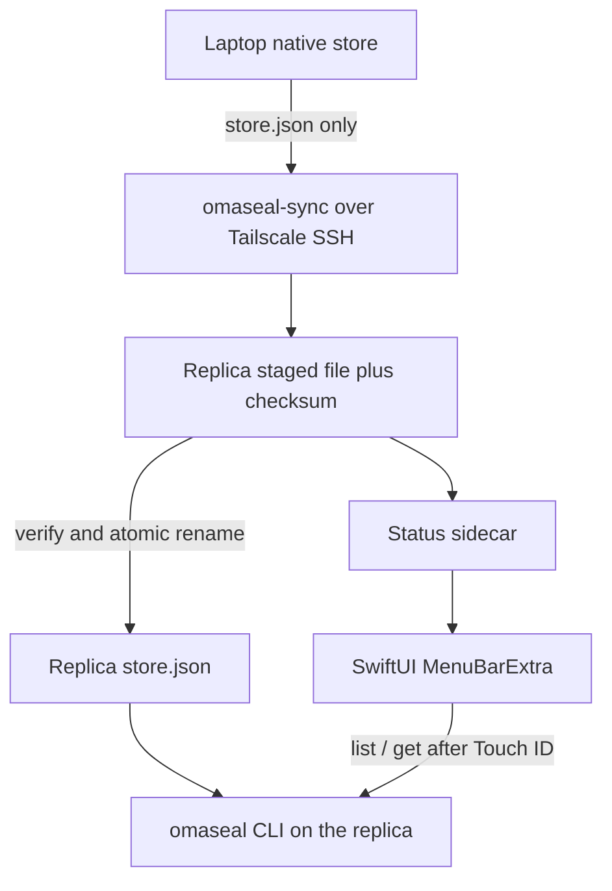

# Plan — macOS menu bar client and a read-only replica Mac

Origin: `docs/brainstorms/2026-11-12-macos-client-and-mini-replica-requirements.md`.
The goal is a second OmaSeal on the replica Mac that stays in sync with the
laptop over Tailscale, plus a SwiftUI menu bar client. Engine work stays
in #70 (macOS build) and #72 (multi-recipient + replica). This plan is
sync and app only. Depth: Standard.

## Problem Frame

The native store on the laptop is the source of truth. When that machine
is offline, agents on the replica Mac have nothing to read. #72 makes a
copied `store.json` decryptable by a second machine key and lets the replica
refuse writes. This plan adds the one-way, checksum-verified copy over
Tailscale SSH, and a menu bar app that shells out to the `omaseal` CLI
for search, Touch ID reveal, copy, and replica status.

## Requirements

**Replica sync**

- R1. The laptop is the only writer. The replica runs in replica mode from
  #72 (`replica: true` or `OMASEAL_REPLICA=1`).
- R2. Each secret is encrypted to the laptop key and the replica key. The
  replica prints its key with `omaseal recipients local`; it is added on
  the laptop with `omaseal recipients add <age1…> --name <name>`.
- R3. Sync copies only `store.json` from the engine's native store
  directory. It never copies `identity.age`, `identity.pub`, `store.lock`,
  tmpfs session files, or `recipients.json`.
- R4. Transport is Tailscale SSH. Install is atomic and checksum-verified.
  A failed transfer leaves the previous replica `store.json` in place.
- R5. An optional allowlist can limit which service/account items are
  written into the replica's `store.json`. Default is a full copy. This is a
  sync-side filter, not an `engine/**` change.
- R6. `contrib/` ships `omaseal-sync`, a laptop systemd path unit plus a
  catch-up timer, and a replica Mac launchd plist.
- R7. Two-way sync is deferred.

**Menu bar app**

- R8. A SwiftUI `MenuBarExtra` app under `macos/` shells out to the
  `omaseal` CLI and never links the engine.
- R9. Search and list show service/account names only.
- R10. Reveal requires a successful LocalAuthentication (Touch ID) check
  before `omaseal get`.
- R11. Copy auto-clears the clipboard after 45 seconds, or the existing
  OmaSeal clipboard-clear interval if one is already documented.
- R12. A status line shows the last successful sync time, and stale or
  failed when the checksum check failed or the interval was missed.

**Quality**

- R13. Unit tests plus a GitHub-hosted macOS `pull_request` workflow. No
  self-hosted runners.
- R14. The app and a runnable macOS CLI depend on #70. Replica mode and
  multi-recipient encryption depend on #72.

## Key Technical Decisions

- KTD1. Laptop pushes; the replica does not write back. A systemd path unit
  on the laptop fires `omaseal-sync` when `store.json` changes; a timer
  catches missed events. The replica launchd job verifies a staged file
  (checksum), atomically renames it onto the replica `store.json`, and
  writes a status sidecar. Launchd may also pull when the replica was down
  and the laptop is reachable. Pull and push are serialized across
  snapshot acquisition and install so an older in-flight transfer cannot
  replace a newer replica: reject a snapshot that is older than the
  installed store (compare source or staging timestamp, or a monotonic
  generation in the sidecar), and never report success for a rejected
  stale snapshot. Governs R4, R6.
- KTD2. The sync protocol is: produce the staging `store.json` (filtered
  when an allowlist is set), compute the SHA-256 of those exact bytes,
  copy that file to a temp path on the replica, verify the hash of the
  received file, then `rename` over `store.json`. The script aborts if
  the destination path is not the native store document, and it refuses
  to write any identity or lock file. Governs R3, R4, R5.
- KTD3. The optional allowlist is applied on the laptop before push, by
  emitting a filtered `store.json` (same envelope schema, fewer items)
  into the staging path. Default is unfiltered. Governs R5.
- KTD4. The menu bar app is a Swift package under `macos/` so
  `swift test` can run on a GitHub-hosted macOS runner without checking
  in an `.xcodeproj`. XcodeGen is an allowed local convenience; it is
  not required for CI. Governs R8, R13.
- KTD5. The app never imports Go code or talks to the store files. CLI
  invocations: `omaseal list` (and search over that list) for R9;
  `omaseal get` only after LocalAuthentication succeeds for R10. Governs
  R8–R10.
- KTD6. Sync status is a non-secret sidecar written by the replica job
  (timestamp, checksum, ok/failed). The app reads that file for the
  status line. It does not infer status by hashing `store.json` itself
  in v1, so a missed job is visible. Governs R12.
- KTD7. No `engine/**` edits in the follow-up implementation PRs that
  execute this plan. Missing engine behavior is a dependency on #70 or
  #72, not a local patch.

## High-Level Technical Design

One-time setup, done by the operator and not automated by the script: on the
replica, first TTY use creates `identity.age` / `identity.pub` and
`omaseal recipients local` prints the `age1…` key; on the laptop,
`omaseal recipients add` rotates every item. After that, every new
`Set` on the laptop is already encrypted to both keys, and sync only
moves `store.json`.

## Implementation Units

### U1. Sync script, systemd units, and launchd

- **Goal:** One-way, atomic, checksum-verified copy of `store.json` from
  the laptop to the replica Mac over Tailscale SSH, with an optional
  allowlist. Covers R1–R7.
- **Dependencies:** Useful end-to-end only after #72 (and #70 to run the
  CLI on the replica). The scripts themselves can land first.
- **Files:**
  - `contrib/omaseal-sync/omaseal-sync` — laptop push script
  - `contrib/omaseal-sync/omaseal-sync.conf.example` — host, paths,
    optional allowlist; placeholders only, no real host keys or names
    that are secrets
  - `contrib/omaseal-sync/omaseal-sync.path`
  - `contrib/omaseal-sync/omaseal-sync.service`
  - `contrib/omaseal-sync/omaseal-sync.timer`
  - `contrib/omaseal-sync/com.omaseal.sync.plist` — replica launchd job
  - `contrib/omaseal-sync/README.md` — setup, including the recipient
    exchange and what must never be copied
  - `contrib/omaseal-sync/omaseal-sync_test.sh` — or a small Go/Python
    test in the same directory that does not need the engine
- **Patterns:** Atomic temp-file + rename, same idea as the native store
  write path in `docs/design/native-store.md`. Refuse any destination
  other than `store.json`.
- **Test scenarios:**
  - T1. A fixture `store.json` pushed to a temp replica dir appears at the
    destination with a matching SHA-256; a `.tmp` staging file is gone.
  - T2. A mid-copy failure, or a checksum mismatch, leaves the previous
    destination bytes bit-identical and records a failed status.
  - T3. Identity files, `recipients.json`, and `store.lock` placed next
    to the destination are not read, written, or deleted.
  - T4. With an allowlist of one service/account, the pushed document
    contains only that item; without an allowlist, all fixture items
    are present.
  - T5. The systemd and launchd unit files point at the script and the
    example config, and do not contain real machine names or keys.
- **Verification:** The tests above pass on the laptop or CI without
  using a live secret store. A dry-run against fixtures prints no secret
  values. Manual check on the replica waits for a later implementation PR
  and is not required to land this unit's scripts.

### U2. Menu bar skeleton and CI

- **Goal:** SwiftUI `MenuBarExtra` under `macos/` that lists and
  searches service/account names via `omaseal list`, plus GitHub-hosted
  macOS CI. Covers R8, R9, R13, R14.
- **Dependencies:** #70 for a real macOS `omaseal` binary. Tests mock
  the CLI so the unit can land before #70 is merged.
- **Files:**
  - `macos/Package.swift`
  - `macos/Sources/OmaSealMenuBar/` — app entry, `MenuBarExtra` scene,
    list/search views, CLI process wrapper
  - `macos/Tests/OmaSealMenuBarTests/` — list/search and CLI-wrapper
    tests
  - `.github/workflows/macos-menubar.yml` — `on: pull_request`,
    `runs-on: macos-latest` (or a pinned GitHub-hosted macOS image),
    `swift test --package-path macos`
- **Patterns:** Isolate the CLI behind a small protocol so tests inject
  a fake process. Never import or vend `engine/**`.
- **Test scenarios:**
  - T6. A mocked `omaseal list` fixture renders the expected
    service/account names and filters them by a search string.
  - T7. A mocked CLI failure shows an error state and does not invent
    names.
  - T8. The workflow file triggers only on `pull_request` (and
    optionally `push` to the app path on GitHub-hosted runners). It
    references no self-hosted label or `runs-on` that is not a
    GitHub-hosted macOS image.
- **Verification:** `swift test --package-path macos` passes locally on
  a Mac and in the GitHub-hosted workflow. `rg -n "self-hosted" .github/workflows/macos-menubar.yml` is empty.

### U3. Reveal and copy with Touch ID

- **Goal:** Reveal runs LocalAuthentication first, then `omaseal get`.
  Copy auto-clears the clipboard. Covers R10, R11.
- **Dependencies:** U2.
- **Files:**
  - `macos/Sources/OmaSealMenuBar/` — presence gate, reveal view, copy
    + clipboard clear
  - `macos/Tests/OmaSealMenuBarTests/` — presence and clipboard tests
    with a mocked LocalAuthentication and a mocked CLI
- **Patterns:** Fail closed: a denied, cancelled, or unavailable Touch
  ID prompt does not call `omaseal get` and does not place a value on
  the clipboard.
- **Test scenarios:**
  - T9. A failed or cancelled presence check does not invoke `get` and
    shows no secret value.
  - T10. A successful presence check calls `get` once for the selected
    service/account and shows the returned value.
  - T11. Copy sets the pasteboard and clears it after the configured
    timeout (use a short test timeout). A second copy restarts the
    timer.
  - T12. The revealed value is not written to logs, files, or the
    replica status sidecar.
- **Verification:** Unit tests T9–T12 pass in `swift test`. No test
  fixture uses a real secret from a live store.

### U4. Replica status line

- **Goal:** The menu bar shows last successful sync time, and stale or
  failed when the sidecar says so or is missing past the expected
  interval. Covers R12.
- **Dependencies:** U1 (sidecar format), U2 (app shell).
- **Files:**
  - `contrib/omaseal-sync/` — status sidecar schema documented in the
    contrib README; writer already in U1
  - `macos/Sources/OmaSealMenuBar/` — status line
  - `macos/Tests/OmaSealMenuBarTests/` — status rendering tests
- **Patterns:** Read only the sidecar. Treat a missing or unreadable
  file as unknown/stale, not as success.
- **Test scenarios:**
  - T13. A sidecar with a successful timestamp renders that time in
    the status line.
  - T14. A failed checksum entry renders a failed state.
  - T15. A missing sidecar, or a success older than the expected
    interval, renders stale/unknown.
- **Verification:** T13–T15 pass in `swift test`. A manual glance on
  the replica after a real sync is a later check, not a gate for the unit
  tests.

## Scope Boundaries

**Deferred for later**

- Two-way sync and conflict resolution.
- Menu bar as a writer on a non-replica Mac.
- Keychain backend, engine launchd, and any `engine/**` change.
- Copies to machines other than the replica Mac.
- Syncing manifest, flags, or agent policy.

**Outside this work**

- Merging #70, #71, #72, or this docs PR, until an explicit merge go-ahead.
- New self-hosted runners.

## Risks & Dependencies

- #70 must land before a real macOS `omaseal` binary exists. App tests
  mock the CLI so they are not blocked; a live replica smoke test is.
- #72 must land before the replica can decrypt a copied `store.json` or
  refuse writes. Syncing before the replica key is added would copy
  ciphertexts the replica cannot read; the contrib README will state that
  order.
- Same-uid honesty from `docs/design/native-store.md` still applies:
  sync is not a new confinement boundary. The gain is the replica staying
  read-only and holding its own identity.
- Tailscale SSH must already work between the laptop and the replica.
  This plan does not set up Tailscale.

## Verification Contract

- U1 tests T1–T5 pass against fixtures, with identity files proven
  untouched and no secret values in output.
- U2–U4 tests T6–T15 pass via `swift test --package-path macos`.
- `.github/workflows/macos-menubar.yml` is GitHub-hosted and
  `pull_request`-triggered only (plus optional GitHub-hosted `push`).
- Follow-up implementation PRs do not modify `engine/**`.

## Definition of Done

- Scripts and units are in `contrib/omaseal-sync/` with a setup README
  that includes the recipient exchange and the never-copy list.
- The menu bar app lists, searches, reveals behind Touch ID, copies
  with auto-clear, and shows replica status.
- CI is green on a GitHub-hosted macOS runner.
- Nothing is merged until an explicit merge go-ahead.

## Sources / Research

- `docs/design/native-store.md` (multi-recipient and replica addendum
  on #72) — encryption set, replica flag, sync-only-`store.json`
  contract.
- `docs/plans/2026-11-12-001-feat-native-multi-recipient-replica-plan.md`
  on #72 — handoff this plan implements.
- #72 — `feat/native-multi-recipient`: `omaseal recipients local` /
  `add`, committed `recipients.json`, `code=replica_readonly`.
- #70 — `feat/macos-engine-build`: darwin build of the engine/CLI;
  required before the replica can run `omaseal`.
- Product authority, 2026-11-12 — second instance on the replica Mac, encrypted
  connection and store, SSH or Tailscale, so agents still have secrets
  when the laptop is offline.
